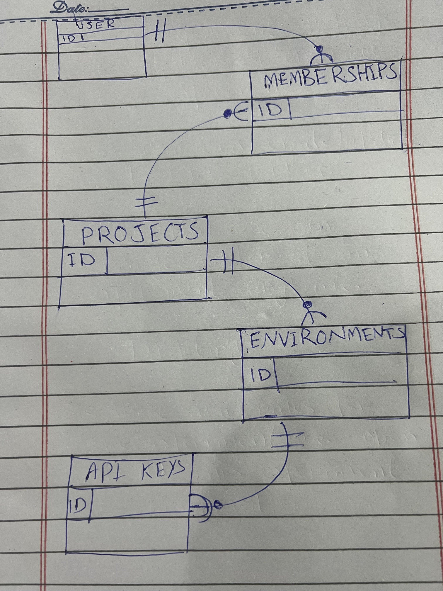
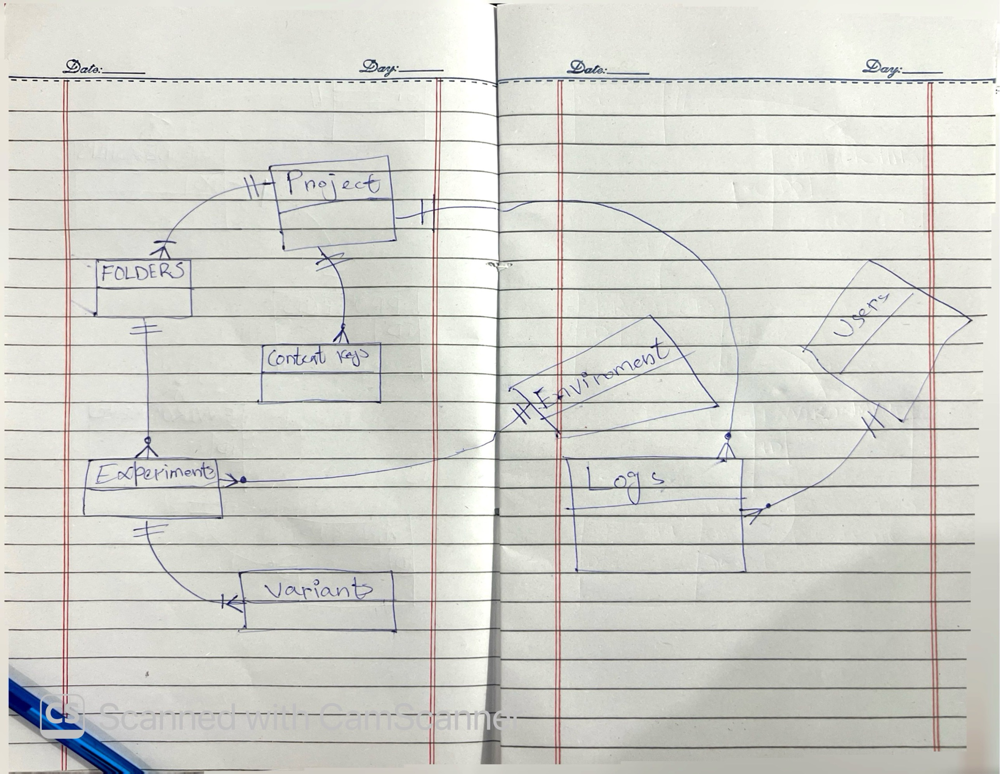

# Schema (v1)

Status: tables, relationships and columns decided. Next: write the SQL.

## Tables

- users
- memberships
- projects
- environments
- api_keys
- folders
- context_keys
- experiments
- variants
- audit_logs

## Relationships

| From | To | Type | Foreign key on |
| --- | --- | --- | --- |
| users | memberships | one to many | memberships.user_id |
| projects | memberships | one to many (at least one admin) | memberships.project_id |
| projects | environments | one to many (two by default) | environments.project_id |
| environments | api_keys | one to many | api_keys.environment_id |
| projects | folders | one to many (default "General") | folders.project_id |
| projects | context_keys | one to many | context_keys.project_id |
| projects | experiments | one to many | experiments.project_id (keeps environment and folder in the same project, see 016) |
| environments | experiments | one to many | experiments.environment_id |
| folders | experiments | one to many | experiments.folder_id |
| experiments | variants | one to many (at least two) | variants.experiment_id |
| users | audit_logs | one to many, user optional | audit_logs.user_id (ON DELETE SET NULL) |
| projects | audit_logs | one to many | audit_logs.project_id (ON DELETE CASCADE) |

Users and projects are many-to-many through memberships.

API keys reach their project through the environment. They have no direct link to projects.

## Columns

Conventions: snake_case, `_id` for foreign keys, `_at` for timestamps. Every primary key is `bigint GENERATED ALWAYS AS IDENTITY` ([014](decisions/014-bigint-primary-keys.md)). Columns are `NOT NULL` unless empty has a stated meaning.

### users

| Column | Type | Null? | Default | Notes |
| --- | --- | --- | --- | --- |
| id | bigint | no | identity | Primary key |
| name | text | no | | |
| email | text | no | | Unique, case-insensitive: unique index on `lower(email)` |
| password_hash | text | no | | Hash only, never the password. Algorithm (bcrypt or argon2id) is chosen in app code |
| created_at | timestamptz | no | `now()` | |
| updated_at | timestamptz | no | `now()` | Set by app code on every update |

### memberships

Primary key: `(user_id, project_id)`, a composite key. This is the one exception to [014](decisions/014-bigint-primary-keys.md): a membership is identified by its user and project, and the key also prevents duplicate memberships.

| Column | Type | Null? | Default | Notes |
| --- | --- | --- | --- | --- |
| user_id | bigint | no | | FK to users.id, ON DELETE CASCADE |
| project_id | bigint | no | | FK to projects.id, ON DELETE CASCADE |
| role | membership_role (ENUM: `admin`, `member`) | no | | No default; always set explicitly |
| created_at | timestamptz | no | `now()` | |
| updated_at | timestamptz | no | `now()` | Set by app code on every update |

Indexes: the primary key covers lookups by user. A separate index on `project_id` covers "all members of this project".

The "at least one admin" rule is checked in app code before removing a member, changing a role or deleting a user. The database can't enforce it.

### projects

| Column | Type | Null? | Default | Notes |
| --- | --- | --- | --- | --- |
| id | bigint | no | identity | Primary key |
| name | text | no | | Not unique: projects are identified by id, and uniqueness only makes sense within a clear parent |
| created_at | timestamptz | no | `now()` | |
| updated_at | timestamptz | no | `now()` | Set by app code on every update |

### environments

| Column | Type | Null? | Default | Notes |
| --- | --- | --- | --- | --- |
| id | bigint | no | identity | Primary key |
| project_id | bigint | no | | FK to projects.id, ON DELETE CASCADE |
| name | text | no | | Unique within the project, case-insensitive: unique index on `(project_id, lower(name))`. Text, not ENUM, because admins create custom environments |
| created_at | timestamptz | no | `now()` | |
| updated_at | timestamptz | no | `now()` | Set by app code on every update |

Staging and production are created by app code when a project is created, not defined in the schema.

Also `UNIQUE (id, project_id)`, so experiments can point a composite foreign key at the pair ([016](decisions/016-composite-fks-keep-experiments-in-one-project.md)).

### api_keys

| Column | Type | Null? | Default | Notes |
| --- | --- | --- | --- | --- |
| id | bigint | no | identity | Primary key |
| environment_id | bigint | no | | FK to environments.id, ON DELETE CASCADE |
| key | text | no | | Globally `UNIQUE`: the config endpoint looks a key up on its own. Generated randomly by app code, never typed by users |
| revoked_at | timestamptz | yes | | Empty means the key is active |
| created_at | timestamptz | no | `now()` | |

No `updated_at`: revoking is the only change, and `revoked_at` records it.

One active key per environment, enforced with a partial unique index:

```sql
CREATE UNIQUE INDEX one_active_key_per_environment
  ON api_keys (environment_id)
  WHERE revoked_at IS NULL;
```

Regenerating runs in one transaction: revoke the old key first, then insert the new one.

### folders

| Column | Type | Null? | Default | Notes |
| --- | --- | --- | --- | --- |
| id | bigint | no | identity | Primary key |
| project_id | bigint | no | | FK to projects.id, ON DELETE CASCADE |
| name | text | no | | Unique within the project, case-insensitive: unique index on `(project_id, lower(name))` |
| is_default | boolean | no | `false` | True for the "General" folder created with each project |
| created_at | timestamptz | no | `now()` | |
| updated_at | timestamptz | no | `now()` | Set by app code on every update |

No column for experiments: the link lives on `experiments.folder_id`.

One default folder per project, enforced with a partial unique index:

```sql
CREATE UNIQUE INDEX one_default_folder_per_project
  ON folders (project_id)
  WHERE is_default;
```

The default folder can't be deleted. App code blocks it (it can still be renamed).

Also `UNIQUE (id, project_id)`, so experiments can point a composite foreign key at the pair ([016](decisions/016-composite-fks-keep-experiments-in-one-project.md)).

Before deleting a folder, app code moves its archived experiments to the default folder. Active experiments block the delete.

### context_keys

| Column | Type | Null? | Default | Notes |
| --- | --- | --- | --- | --- |
| id | bigint | no | identity | Primary key |
| project_id | bigint | no | | FK to projects.id, ON DELETE CASCADE |
| key | text | no | | `UNIQUE (project_id, key)`. `CHECK (key ~ '^[a-z][a-z0-9_]*$')`: lowercase letters, numbers and underscores. Never changes after creation |
| type | context_key_type (ENUM: `string`, `number`, `boolean`) | no | | Can't change while experiments use the key |
| created_at | timestamptz | no | `now()` | |
| updated_at | timestamptz | no | `now()` | Set by app code on every update |

A context key is a definition: its name and type. Values live in targeting rules and come from visitors at runtime.

Targeting references keys by name inside JSONB, not by foreign key, so "can't delete or change type while in use" is checked in app code.

The key stays case-sensitive (the SDK matches attribute names exactly). The format check prevents `Device` and `device` from both existing.

### experiments

| Column | Type | Null? | Default | Notes |
| --- | --- | --- | --- | --- |
| id | bigint | no | identity | Primary key |
| project_id | bigint | no | | FK to projects.id, ON DELETE CASCADE |
| environment_id | bigint | no | | Composite FK `(environment_id, project_id)` to environments `(id, project_id)`, ON DELETE NO ACTION |
| folder_id | bigint | no | | Composite FK `(folder_id, project_id)` to folders `(id, project_id)`, ON DELETE NO ACTION |
| key | text | no | | `UNIQUE (environment_id, key)`. `CHECK (key ~ '^[a-z0-9]+(-[a-z0-9]+)*$')`, e.g. `checkout-v2`. Never changes after creation |
| name | text | no | | |
| description | text | yes | | Empty means no description |
| status | experiment_status (ENUM: `draft`, `running`, `stopped`) | no | `'draft'` | Transitions checked in app code. `status <> 'draft'` means it has run, so config is locked |
| targeting | jsonb | no | `'[]'` | List of rules in the assignment engine's shape, joined with AND |
| seed | integer | no | `0` | Part of the hash. Never changed in v1; v2 phases use it to re-randomize |
| archived_at | timestamptz | yes | | Empty means not archived. A running experiment can't be archived |
| created_at | timestamptz | no | `now()` | |
| updated_at | timestamptz | no | `now()` | Set by app code on every update |

No column for variants (the link lives on `variants.experiment_id`), conversion events (v2) or creator (the audit log's create entry records it).

**One project per experiment:** the composite foreign keys share one `project_id`, so the environment and the folder must both belong to the experiment's project, or the row is rejected.

**Deleting:**
- Deleting an environment or folder that still has experiments (active or archived) fails: `NO ACTION` checks at the end of the statement
- Deleting a project succeeds: the cascade through `project_id` removes its experiments within the same statement, before that check runs ([017](decisions/017-no-action-instead-of-restrict.md))
- To verify in psql: deleting an environment with an experiment fails; deleting its project succeeds

**Indexes:** `UNIQUE (environment_id, key)` covers lookups by environment. Add indexes on `folder_id` and `project_id` (foreign key columns aren't indexed automatically, and the cascade on project delete searches by `project_id`).

### variants

| Column | Type | Null? | Default | Notes |
| --- | --- | --- | --- | --- |
| id | bigint | no | identity | Primary key. v2 exposure events will point here |
| experiment_id | bigint | no | | FK to experiments.id, ON DELETE CASCADE (only happens when a project is deleted; experiments are archived, not deleted) |
| key | text | no | | `UNIQUE (experiment_id, key)`. Same format as experiment keys: `CHECK (key ~ '^[a-z0-9]+(-[a-z0-9]+)*$')` |
| name | text | no | | |
| is_control | boolean | no | `false` | At most one per experiment (partial unique index below) |
| weight | integer | no | | `CHECK (weight BETWEEN 0 AND 100)`. Integer, not numeric: no decimals needed (34/33/33 works), and avoids JavaScript rounding when summing |
| position | integer | no | | `UNIQUE (experiment_id, position)`. Always read with `ORDER BY position`: the assignment engine depends on order |
| created_at | timestamptz | no | `now()` | |
| updated_at | timestamptz | no | `now()` | Set by app code on every update |

At most one control per experiment, enforced with a partial unique index:

```sql
CREATE UNIQUE INDEX one_control_per_experiment
  ON variants (experiment_id)
  WHERE is_control;
```

Checked in app code, inside the save transaction (the database can't check across rows):
- Exactly one control (the index covers "at most one")
- At least two variants, counting control
- Weights sum to 100
- No changes once the experiment has run (`status <> 'draft'`)

### audit_logs

| Column | Type | Null? | Default | Notes |
| --- | --- | --- | --- | --- |
| id | bigint | no | identity | Primary key |
| project_id | bigint | no | | FK to projects.id, ON DELETE CASCADE |
| user_id | bigint | yes | | FK to users.id, ON DELETE SET NULL. Empty means the user was deleted |
| user_email | text | no | | Copy of the user's email at the time of the change, so entries stay readable after the user is deleted. Deliberate duplication: a log records what was true then |
| action | log_action (ENUM: `create`, `update`, `delete`) | no | | |
| entity_type | log_entity (ENUM: `project`, `membership`, `environment`, `api_key`, `folder`, `context_key`, `experiment`, `variant`) | no | | Polymorphic reference ([010](decisions/010-polymorphic-audit-log.md)) |
| entity_id | bigint | no | | Not a foreign key; the row may no longer exist. For memberships (no single id), this is the user's id; the project is in `project_id` |
| before | jsonb | yes | | Update: changed fields only. Delete: full row. Create: empty ([011](decisions/011-audit-log-changed-fields-only.md)) |
| after | jsonb | yes | | Update: changed fields only. Create: full row. Delete: empty |
| created_at | timestamptz | no | `now()` | |

No `updated_at`: logs never change.

**Append-only** ([012](decisions/012-audit-log-append-only.md)): the app connects as its own database user, separate from the user that owns the tables, with:

```sql
REVOKE UPDATE, DELETE ON audit_logs FROM app_user;
```

A trigger was rejected because it would also block the cascade when a project is deleted.

**Indexes:**
- `(project_id, created_at)`: recent changes in a project
- `(entity_type, entity_id)`: history of one thing

## To verify in psql

Behaviors this design depends on, to test when the schema is first run:

1. An experiment pointing at another project's folder or environment is rejected (composite foreign keys, 016)
2. Deleting an environment that has experiments fails; deleting its project succeeds (NO ACTION, 017)
3. A second active API key for one environment is rejected; any number of revoked keys is fine (partial unique index)
4. A second control variant in one experiment is rejected (partial unique index)
5. The app user can't update or delete audit logs, but deleting a project still removes its logs (REVOKE and cascade)

## Sketches

The hand-drawn relationship sketches.




